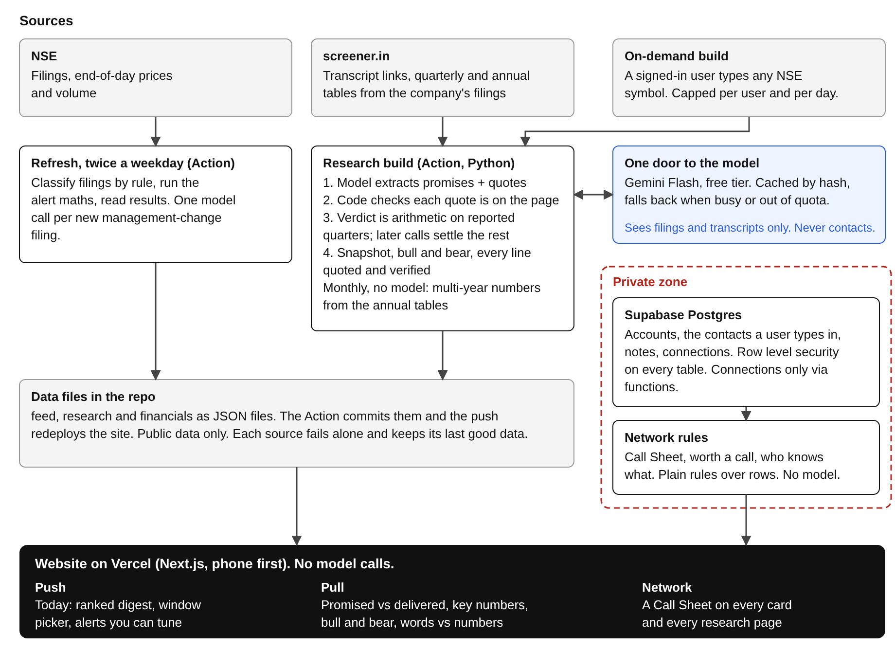

# FINN: what I built, and why

FINN is a briefing for an investor, not a dashboard. It does three things and ties them together.

- **Push.** A short, ranked digest of what changed in the portfolio, plus alerts when a price or volume rule trips.
- **Pull.** Research on any NSE company, grounded only in primary sources: earnings call transcripts and filings. The headline feature is *promised vs delivered*: what management said it would do, and whether the reported numbers agree.
- **Network.** The investor's contacts. They are not a separate tab. Every feed card and every research page ends in a **Call Sheet**: who in your network could explain this, and why, in plain facts.

Live demo: https://finn-blush.vercel.app (works on a phone). Code: this repository.

The diagram as an editable file: [architecture.svg](architecture.svg).

## What I chose to build thin, and what I left out

I preferred a small thing that works over a broad thing that breaks.

Built: the three layers above, real accounts and connections, on-demand research for any ticker, and a mock network that overlaps the portfolio. Left out on purpose: a free-form ask bar, push notifications (the digest is a page), and reading annual reports as text. The limits section says exactly what that costs.

## Data pipelines

| Stream | Source | How it is processed |
|---|---|---|
| Filings | NSE announcements | Rule-based classifier gives each filing a priority. No model. |
| Prices and volume | End-of-day prices | Alert maths: volume at or above 2x the 20-day average, or a move of 5% or more. Both thresholds are settings. |
| Transcripts | screener.in links to the PDFs on BSE | Download, extract text page by page, cache by file hash. |
| Reported numbers | screener.in quarterly table | Revenue, EBITDA, PBT, PAT per quarter. Parsed, no model. |

**The Today feed.** The investor picks the window (24 hours, 3, 7 or 14 days) and sets what counts as unusual: the volume multiple, the price move, and which filing types to show. Settings live in a cookie on the device. Alerts are decided in the app from the price rows the feed ships, using the same maths as the pipeline (a shared test fixture keeps the two identical). Priority 0 is dropped. Priority 1 is counted ("14 routine filings hidden"), not shown. Priority 2 and up becomes cards, ranked by priority then recency. Results cards use the real reported quarters. Management-change cards quote the filing itself, and a check confirms the name, quote and previous employers appear in the filing text before the card is shown. Every event card links to the original filing.

**Refresh.** A scheduled GitHub Action (08:00 and 18:00 IST on weekdays) reads filings, prices and results numbers, asks the model only about management-change filings it has not read before (one call each, cached), and commits the new feed, which redeploys the site. Each source fails on its own: if NSE blocks the runner, the feed keeps its last filings, the page says when they were last read, and prices still update. `scripts/refresh_feed.py` does the same from a laptop.

**Promised vs delivered.**
1. A model reads a transcript and returns each forward-looking claim as JSON, with the **verbatim quote** and the page.
2. Code checks that the quote really exists on that page. If not, the claim is dropped. Any number must appear in the quote, or it is blanked.
3. The verdict is **arithmetic on the reported quarters**, not a model's opinion. FY26 revenue of 3,626 cr against a guided 4,000 cr or more is "missed", by subtraction. A future year is "pending", with year-to-date shown.
4. A claim the table cannot check (segment revenue, capex) is **pending** while its year is still running ("due FY27: 2 of 4 quarters reported so far"). Once the year has ended, a second step reads the later call that reports it. A model finds where management states the actual number (up to 3 requests per company, on pages picked by keyword), code checks the quote is verbatim on that page, the number is inside the quote, and the unit and period match. The verdict is then the same arithmetic as before, and the page shows the later quote beside the original. If any check fails, the claim stays "can't check yet". It never guesses.

**Business snapshot, bull and bear.** One model request per company reads the opening pages and the pages most about demand, margins and risks in the latest call. It returns what the company does (by segment), three reasons it could work and three reasons it might not. Every line carries a verbatim quote and page number. A line whose quote is not on that page, or whose number is not in its quote, is dropped, so the model chooses and phrases but cannot invent evidence. The page labels this Draft when a test model wrote it.

**What they said, against the numbers.** Plain rules put the checked promises beside the multi-year numbers. If management kept its promises while profit is not turning into cash, or debt is rising, the page says so in one headline and lists the warnings. No model. A "key numbers" block at the top shows the latest year's revenue, profit, margin, return on capital, debt to equity and operating cash.

**Multi-year view.** Three more sections on each research page, all arithmetic on the annual tables (profit and loss, balance sheet, cash flow, ratios) that screener.in standardises from the company's own filings. No model, no cost.
- **Trajectory:** revenue by year with operating margin, the 3-year growth rate, and whether margin is expanding or compressing.
- **Balance sheet:** borrowings against net worth, interest cover, how the company is funded, and whether the cash conversion cycle is lengthening.
- **Cash quality:** profit against operating cash flow, year by year. If profit is not turning into cash, it says so in a plain sentence.
Each section is left out when its table is incomplete, and a growth rate is never computed from a zero or negative base. A monthly Action refreshes the portfolio's numbers; an on-demand build reads them for the new company in the same run.

**Finding the right company.** Search matches what you type against NSE's own list of about 2,000 listed companies: a symbol, part of a name or a near miss ("asain paint" finds Asian Paints). A symbol that is not on the list gets "not found" with the closest names, and never starts a build, so it cannot waste a daily cap. Plain matching, no model; the list is refreshed monthly.

**Works on any ticker.** `python -m pipeline.build_company TICKER` does everything from nothing. On the site, a signed-in user can type any NSE symbol and tap Build. TITAN and ASIANPAINT were built that way, with no code change.

## LLM routing and efficiency

The rule: use a model only where a rule cannot do the job, and never let it be the judge of a number.

| Step | Tool |
|---|---|
| Filing classification, alerts, verdicts, Call Sheet matching, feed ranking | Plain code. No model. |
| Claim extraction from transcripts | Gemini Flash, with quote verification |
| Segment promises, from later calls | Gemini Flash, up to 3 requests per company, quote and number verified, verdict by arithmetic |
| Business summary, bull and bear | Gemini Flash, 1 request per company, every line verified against a quote |
| Narrative vs numbers, key numbers | Plain code. No model. |
| Management-change extraction from a filing | Gemini Flash, verified against the filing text |

- **One door** (`pipeline/llm.py`): every call goes through one wrapper. It caches each answer on disk by a hash of model, prompt and version, so a rerun costs nothing. It retries busy servers, and falls back through a list of models when one is overloaded or its daily quota is used up.
- **Quota awareness.** The free tier is small, so a build stops with a plain "API limit reached" message instead of failing. In the on-demand job, the cache is saved between runs, so a stopped build resumes without paying again.
- **A test model for drafts.** To fill the portfolio without spending Gemini quota, I built the draft research for most portfolio stocks with a separate test model (Hyde's GLM). That output is labelled **Draft** on the page. No deployed code ever calls that model. The website has no model calls at all, the on-demand job refuses any provider except Gemini, and the test key exists only on my machine. Kaynes, TITAN, ASIANPAINT, OLAELEC and SBIN were built with Gemini.

## Privacy and security

The network is the sensitive part, so the rules are in the database, not the website.

- **Row level security on every table.** The owner reads their own address book. Career details of another user are readable only by them and by their *accepted* connections. A pending request shows a name and headline only.
- **Connections can only be made through functions** (`request_connection`, `respond_connection`). A stranger can look up someone by *exact* username and gets a display name back, nothing else. There is no search and no browsing, so nobody can scan for people.
- **Notes stay private.** What you wrote about a contact, including the month you last spoke, is never shared with that contact. Only the row's owner can change it.
- **The model never sees the network.** The Call Sheet is rules over rows. No contact data is sent to any model.
- **Demo accounts.** Three invented people (`demo_priya`, `demo_kabir`, `demo_meera`) accept connection requests instantly, so a reviewer can see the real connection flow alone. Nobody can sign in as them, and only the setup script can mark an account as a demo. The database tests check that a user cannot do it to themselves.
- **Signed-out visitors see an invented network**, labelled synthetic. Real users see only their own contacts and their accepted connections.
- **Secrets.** The Gemini key and the Supabase secret key live only in GitHub Actions secrets. The website holds the public anon key and one token that can start exactly one workflow. Per-user and global daily caps stop anyone burning the quota.
- **Tested on real Postgres.** 29 tests try to break these rules: a stranger reading careers, writing tables directly, and calling functions without signing in.

For a real deployment I would add: consent per data source, encryption at rest, retention limits, delete-on-request, and an audit log. The prototype only uses data users typed in themselves, or invented people.

## Cloud services

| Piece | Where | Why |
|---|---|---|
| Website | Vercel (Next.js, Tailwind) | Free, deploys from GitHub, mobile first |
| Database, sign-in, access rules | Supabase (Postgres, Auth) | Real row level security, which is where the privacy rules live |
| On-demand research builds | GitHub Actions | Free, runs the same Python as the CLI, holds the secrets, nothing to host |
| Model | Google AI Studio (Gemini), free tier | Cheap, structured output |

No servers to keep alive.

## The Network, woven in

The mock network has 120 invented people, 36 employers and 30 employer relations (competitor, supplier, customer), built to overlap the 17-stock portfolio and the research companies. A Call Sheet ranks people by rule: worked at the company, then at a competitor, supplier or customer, then overlapped with someone who did. Each line is a plain fact tagged by source ("public profile", "their profile", "your notes"). There is no strength score, because I could not defend one.

Two things the Network notices without being asked, both plain rules over the contacts and the feed:
- **Worth a call.** A contact who worked at a company that just filed, and whom you have not spoken to in six months or more. It shows the career line, the filing, the silence, and one question to ask, chosen by filing type. Still-there contacts rank above former ones. A pointer on Today shows how many there are for the window picked.
- **Who knows what.** Go-to people per sector, counted from years at companies FINN tracks. A sector where you hold companies and know no one is flagged as a gap.

**A profile for every name.** Tap any contact's name, on a Call Sheet, in Worth a call, in Who knows what or on the Network tab, and their profile opens: career, education, when you last spoke, and the tracked companies they have worked at. Under the name is a **Last spoke** month picker: you set or clear the month yourself, and it feeds Worth a call and the draft email. Contacts made by connecting with a real person start blank until you set it. Right under their name is **Draft an email**. It opens an editable first draft made by plain template rules from facts we hold (a role they had, how long since you spoke), and never claims a tie the data does not show. It opens in the investor's own mail app or copies. FINN holds no email addresses and sends nothing, and the text never goes to a model.

If a contact typed their employer by hand, it is matched to a tracked company by name. The model never sees the network.

## Known limits (said plainly)

- Many promises still read "can't check yet". Segment and capex claims are settled only when a later call states the number plainly for the same period, and often it does not. Running years show "pending" instead.
- Annual reports are not read as text. Multi-year numbers come from screener.in's standardised annual tables, and the business summary and bull and bear come from the latest call only.
- Research for most portfolio stocks is a draft from a test model. Treat the promise lists as indicative.
- The free Gemini quota allows about five companies a day, which is why on-demand building has daily caps.
- screener.in is a single point of dependency for documents and quarterly numbers.
- Matching a person's typed employer to a company is by name and first whole words. It is a heuristic and can miss.
- The digest is a page. Nothing is pushed to the phone.

## AI build history

I built this with Claude as a pair programmer, working in small steps with tests at each step. The conversation history is linked in the covering email.
